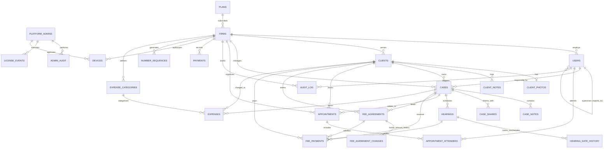

# DATABASE.md — Database Architecture & Schema Reference

Target Database: PostgreSQL 16  
ORM & Migrations: Drizzle ORM (`drizzle-orm`, `drizzle-kit`)  
Schema Definition: `server/src/db/schema.ts`  
Migration Folder: `server/drizzle/`

---

## 1. Architectural Principles

1. **Multi-Tenant Scoping**:
   - Every tenant table contains a mandatory `firm_id` referencing `firms.id`.
   - All tenant queries MUST include `WHERE firm_id = $firmId`.
   - Compound indexes place `firm_id` as the leading column (`idx_<table_name>_firm_id`).
2. **Soft Delete Policy**:
   - Standard business entities utilize soft deletion: `deleted_at timestamp with time zone NULL`.
   - Active queries MUST filter by `deleted_at IS NULL`.
   - Never execute raw `DELETE` SQL queries on tenant business tables.
3. **Audit Trail**:
   - Every database mutation produces an immutable record in `audit_log`.
   - Before/after states are captured as `jsonb` diffs with operator identity (`user_id`, `user_name`).
4. **Sensitive Data Protection**:
   - Passwords stored as salted bcrypt hashes (`password_hash`).
   - Device keys stored as SHA-256 cryptographic digests (`device_key_hash`), never in raw plaintext.
   - Audit logs strictly exclude passwords, tokens, session cookies, and binary photo payloads.

---

## 2. Entity-Relationship Diagram (Mermaid)



---

## 3. Schema Catalog & Status

### 3.1 Platform Super Admin (Tenant-Agnostic) `[BUILT]`

#### `platform_admins`
Platform administration credentials for the software owner. Independent of tenant firms.
```sql
CREATE TABLE platform_admins (
    id UUID PRIMARY KEY DEFAULT gen_random_uuid(),
    email TEXT UNIQUE NOT NULL,
    password_hash TEXT NOT NULL,
    totp_secret TEXT,
    active BOOLEAN NOT NULL DEFAULT true,
    failed_attempts INTEGER NOT NULL DEFAULT 0,
    locked_until TIMESTAMPTZ,
    created_at TIMESTAMPTZ NOT NULL DEFAULT NOW(),
    updated_at TIMESTAMPTZ NOT NULL DEFAULT NOW()
);
```

#### `admin_audit`
Immutable trail of all super admin modifications.
```sql
CREATE TABLE admin_audit (
    id UUID PRIMARY KEY DEFAULT gen_random_uuid(),
    admin_id UUID NOT NULL REFERENCES platform_admins(id),
    action TEXT NOT NULL,
    target_firm_id TEXT,
    old JSONB,
    new JSONB,
    ip TEXT,
    at TIMESTAMPTZ NOT NULL DEFAULT NOW()
);
```

#### `license_events`
Chamber subscription and licensing lifecycle events.
```sql
CREATE TABLE license_events (
    id UUID PRIMARY KEY DEFAULT gen_random_uuid(),
    firm_id TEXT NOT NULL REFERENCES firms(id),
    type TEXT NOT NULL,
    old JSONB,
    new JSONB,
    by_admin UUID NOT NULL REFERENCES platform_admins(id),
    at TIMESTAMPTZ NOT NULL DEFAULT NOW()
);
```

---

### 3.2 Tenant Management & Licensing `[BUILT]`

#### `plans`
SaaS subscription pricing tiers.
```sql
CREATE TABLE plans (
    id TEXT PRIMARY KEY,
    name TEXT NOT NULL,
    duration_months INTEGER NOT NULL,
    price_bdt INTEGER NOT NULL,
    seats INTEGER NOT NULL,
    features JSONB DEFAULT '[]'::jsonb,
    created_at TIMESTAMPTZ NOT NULL DEFAULT NOW(),
    updated_at TIMESTAMPTZ NOT NULL DEFAULT NOW(),
    deleted_at TIMESTAMPTZ,
    created_by TEXT,
    updated_by TEXT
);
```

#### `firms`
Chambers/law firm tenants.
```sql
CREATE TABLE firms (
    id TEXT PRIMARY KEY,
    firm_id TEXT NOT NULL,
    name TEXT NOT NULL,
    bar_council_reg TEXT,
    office_address TEXT,
    court_affiliations TEXT,
    contact TEXT,
    max_devices INTEGER NOT NULL DEFAULT 5,
    device_policy TEXT NOT NULL DEFAULT 'auto-approve', -- 'auto-approve' | 'manual'
    allow_owner_device_removal BOOLEAN NOT NULL DEFAULT false,
    visibility_mode TEXT NOT NULL DEFAULT 'team',        -- 'open' | 'team'
    plan_id TEXT REFERENCES plans(id),
    license_starts_at TIMESTAMPTZ,
    license_expires_at TIMESTAMPTZ NOT NULL,
    status TEXT NOT NULL DEFAULT 'active',               -- 'active' | 'expired' | 'suspended' | 'disabled'
    created_at TIMESTAMPTZ NOT NULL DEFAULT NOW(),
    updated_at TIMESTAMPTZ NOT NULL DEFAULT NOW(),
    deleted_at TIMESTAMPTZ,
    created_by TEXT,
    updated_by TEXT
);
```

#### `devices`
Browser installation authorization tracking per chamber seat.
```sql
CREATE TABLE devices (
    id UUID PRIMARY KEY DEFAULT gen_random_uuid(),
    firm_id TEXT NOT NULL REFERENCES firms(id),
    user_id TEXT NOT NULL REFERENCES users(id),
    device_key_hash TEXT UNIQUE NOT NULL,
    name TEXT NOT NULL,
    user_agent TEXT NOT NULL,
    status TEXT NOT NULL DEFAULT 'pending', -- 'pending' | 'approved' | 'rejected' | 'revoked'
    first_seen_at TIMESTAMPTZ NOT NULL DEFAULT NOW(),
    last_seen_at TIMESTAMPTZ NOT NULL DEFAULT NOW(),
    approved_by_admin_id UUID REFERENCES platform_admins(id)
);
CREATE INDEX idx_devices_firm_id ON devices(firm_id);
CREATE INDEX idx_devices_user_id ON devices(user_id);
CREATE INDEX idx_devices_status ON devices(status);
```

---

### 3.3 Users & Team Hierarchy `[BUILT]`

#### `users`
Chamber advocates and support staff.
```sql
CREATE TABLE users (
    id TEXT PRIMARY KEY,
    firm_id TEXT NOT NULL REFERENCES firms(id),
    name TEXT NOT NULL,
    email TEXT UNIQUE NOT NULL,
    password_hash TEXT NOT NULL,
    role TEXT NOT NULL,                         -- 'Owner' | 'Staff'
    job_type TEXT NOT NULL DEFAULT 'other',     -- 'lawyer_senior' | 'lawyer_junior' | 'clerk' | 'receptionist' | 'intern' | 'other'
    job_title_label TEXT,
    reports_to_user_id TEXT,                    -- Self-referential supervisory link
    permissions JSONB NOT NULL,                 -- string[] of permission keys
    language TEXT NOT NULL DEFAULT 'en',        -- 'en' | 'bn'
    active BOOLEAN NOT NULL DEFAULT true,
    must_change_password BOOLEAN NOT NULL DEFAULT false,
    failed_login_attempts INTEGER NOT NULL DEFAULT 0,
    locked_until TIMESTAMPTZ,
    created_at TIMESTAMPTZ NOT NULL DEFAULT NOW(),
    updated_at TIMESTAMPTZ NOT NULL DEFAULT NOW(),
    deleted_at TIMESTAMPTZ,
    created_by TEXT,
    updated_by TEXT
);
CREATE INDEX idx_users_firm_id ON users(firm_id);
CREATE INDEX idx_users_email ON users(email);
CREATE INDEX idx_users_reports_to ON users(reports_to_user_id);
```

---

### 3.4 Clients Module `[BUILT]`

#### `clients`
```sql
CREATE TABLE clients (
    id TEXT PRIMARY KEY,
    firm_id TEXT NOT NULL REFERENCES firms(id),
    name TEXT NOT NULL,
    name_bn TEXT,
    phone TEXT NOT NULL,
    email TEXT,
    address TEXT NOT NULL,
    notes TEXT,
    archived BOOLEAN NOT NULL DEFAULT false,
    created_at TIMESTAMPTZ NOT NULL DEFAULT NOW(),
    updated_at TIMESTAMPTZ NOT NULL DEFAULT NOW(),
    deleted_at TIMESTAMPTZ,
    created_by TEXT,
    updated_by TEXT
);
CREATE INDEX idx_clients_firm_id ON clients(firm_id);
CREATE INDEX idx_clients_name ON clients(name);
CREATE INDEX idx_clients_phone ON clients(phone);
```

#### `client_photos`
Resized profile avatar image storage (max 300KB).
```sql
CREATE TABLE client_photos (
    client_id TEXT PRIMARY KEY REFERENCES clients(id) ON DELETE CASCADE,
    firm_id TEXT NOT NULL REFERENCES firms(id) ON DELETE CASCADE,
    mime TEXT NOT NULL,                         -- 'image/jpeg' | 'image/webp' | 'image/png'
    bytes TEXT NOT NULL,                        -- Base64 encoded payload
    updated_at TIMESTAMPTZ NOT NULL DEFAULT NOW()
);
CREATE INDEX idx_client_photos_firm_id ON client_photos(firm_id);
```

#### `client_notes`
```sql
CREATE TABLE client_notes (
    id TEXT PRIMARY KEY,
    firm_id TEXT NOT NULL REFERENCES firms(id),
    client_id TEXT NOT NULL REFERENCES clients(id),
    note_date TEXT NOT NULL,                    -- 'YYYY-MM-DD'
    body TEXT NOT NULL,                         -- Up to 5,000 characters
    created_by TEXT,
    updated_by TEXT,
    created_at TIMESTAMPTZ NOT NULL DEFAULT NOW(),
    updated_at TIMESTAMPTZ NOT NULL DEFAULT NOW(),
    deleted_at TIMESTAMPTZ
);
CREATE INDEX idx_client_notes_firm_id ON client_notes(firm_id);
CREATE INDEX idx_client_notes_client_id ON client_notes(client_id);
CREATE INDEX idx_client_notes_note_date ON client_notes(note_date);
```

---

### 3.5 Cases Module `[BUILT]`

#### `cases`
```sql
CREATE TABLE cases (
    id TEXT PRIMARY KEY,
    firm_id TEXT NOT NULL REFERENCES firms(id),
    client_id TEXT NOT NULL REFERENCES clients(id),
    file_serial TEXT,
    case_number TEXT NOT NULL,
    court TEXT NOT NULL,
    matter_type TEXT NOT NULL,
    description TEXT,
    plaintiff TEXT,
    defendant TEXT,
    our_role TEXT,
    plaintiff_lawyer TEXT,
    defendant_lawyer TEXT,
    responsible_lawyer_id TEXT,
    status TEXT NOT NULL DEFAULT 'ongoing',     -- 'ongoing' | 'pending' | 'closed'
    case_date TIMESTAMPTZ,                      -- Filing date
    closed_on TIMESTAMPTZ,                      -- Disposal date
    case_category TEXT NOT NULL DEFAULT 'civil',-- 'civil' | 'criminal_gr' | 'criminal_cr' | 'other'
    party_a_role TEXT,
    party_b_role TEXT,
    police_station TEXT,
    sections_of_law TEXT,
    restricted BOOLEAN NOT NULL DEFAULT false,
    next_hearing_at TIMESTAMPTZ,
    created_at TIMESTAMPTZ NOT NULL DEFAULT NOW(),
    updated_at TIMESTAMPTZ NOT NULL DEFAULT NOW(),
    deleted_at TIMESTAMPTZ,
    created_by TEXT,
    updated_by TEXT
);
CREATE INDEX idx_cases_firm_id ON cases(firm_id);
CREATE INDEX idx_cases_client_id ON cases(client_id);
CREATE INDEX idx_cases_case_number ON cases(case_number);
CREATE INDEX idx_cases_court ON cases(court);
CREATE INDEX idx_cases_status ON cases(status);
CREATE INDEX idx_cases_file_serial ON cases(file_serial);
CREATE INDEX idx_cases_resp_lawyer ON cases(responsible_lawyer_id);
CREATE INDEX idx_cases_case_date ON cases(case_date);
CREATE INDEX idx_cases_category ON cases(case_category);
CREATE UNIQUE INDEX uidx_cases_firm_file_serial ON cases(firm_id, file_serial);
```

#### `case_notes`
```sql
CREATE TABLE case_notes (
    id TEXT PRIMARY KEY,
    firm_id TEXT NOT NULL REFERENCES firms(id),
    case_id TEXT NOT NULL REFERENCES cases(id),
    note_date TEXT NOT NULL,                    -- 'YYYY-MM-DD'
    body TEXT NOT NULL,
    created_by TEXT,
    updated_by TEXT,
    created_at TIMESTAMPTZ NOT NULL DEFAULT NOW(),
    updated_at TIMESTAMPTZ NOT NULL DEFAULT NOW(),
    deleted_at TIMESTAMPTZ
);
CREATE INDEX idx_case_notes_firm_id ON case_notes(firm_id);
CREATE INDEX idx_case_notes_case_id ON case_notes(case_id);
CREATE INDEX idx_case_notes_note_date ON case_notes(note_date);
```

#### `case_shares`
```sql
CREATE TABLE case_shares (
    id TEXT PRIMARY KEY,
    firm_id TEXT NOT NULL REFERENCES firms(id),
    case_id TEXT NOT NULL REFERENCES cases(id),
    user_id TEXT NOT NULL REFERENCES users(id),
    created_by TEXT NOT NULL,
    created_at TIMESTAMPTZ NOT NULL DEFAULT NOW(),
    deleted_at TIMESTAMPTZ
);
CREATE INDEX idx_case_shares_firm_id ON case_shares(firm_id);
CREATE INDEX idx_case_shares_case_id ON case_shares(case_id);
CREATE INDEX idx_case_shares_user_id ON case_shares(user_id);
```

---

### 3.6 Hearings Module & Date Fixed For

#### `hearings` `[BUILT]` with `[PLANNED]` Columns
```sql
CREATE TABLE hearings (
    id TEXT PRIMARY KEY,
    firm_id TEXT NOT NULL REFERENCES firms(id),
    case_id TEXT NOT NULL REFERENCES cases(id),
    appearing_lawyer_id TEXT,
    scheduled_at TIMESTAMPTZ NOT NULL,
    court TEXT,
    purpose TEXT,
    status TEXT NOT NULL DEFAULT 'scheduled',   -- 'scheduled' | 'held' | 'adjourned' | 'cancelled'
    outcome_note TEXT,
    -- [PLANNED for Phase 2]
    fixed_for TEXT,                             -- Controlled key per case category
    fixed_for_note TEXT,                        -- Free-text note (max 200 chars)
    created_at TIMESTAMPTZ NOT NULL DEFAULT NOW(),
    updated_at TIMESTAMPTZ NOT NULL DEFAULT NOW(),
    deleted_at TIMESTAMPTZ,
    created_by TEXT,
    updated_by TEXT
);
CREATE INDEX idx_hearings_firm_id ON hearings(firm_id);
CREATE INDEX idx_hearings_case_id ON hearings(case_id);
CREATE INDEX idx_hearings_appearing_lawyer ON hearings(appearing_lawyer_id);
-- [PLANNED] CREATE INDEX idx_hearings_fixed_for ON hearings(fixed_for);
```

#### `hearing_date_history` `[BUILT]` with `[PLANNED]` Columns
```sql
CREATE TABLE hearing_date_history (
    id TEXT PRIMARY KEY,
    hearing_id TEXT NOT NULL,
    case_id TEXT NOT NULL,
    old_at TIMESTAMPTZ NOT NULL,
    new_at TIMESTAMPTZ NOT NULL,
    reason TEXT NOT NULL,
    changed_by TEXT NOT NULL,
    changed_at TIMESTAMPTZ NOT NULL DEFAULT NOW(),
    -- [PLANNED for Phase 2]
    old_fixed_for TEXT,
    new_fixed_for TEXT
);
CREATE INDEX idx_hearing_history_hearing_id ON hearing_date_history(hearing_id);
CREATE INDEX idx_hearing_history_case_id ON hearing_date_history(case_id);
```

---

### 3.7 Appointments Module `[BUILT]`

#### `appointments`
```sql
CREATE TABLE appointments (
    id TEXT PRIMARY KEY,
    firm_id TEXT NOT NULL REFERENCES firms(id),
    title TEXT NOT NULL,
    type TEXT NOT NULL,                         -- 'client_meeting' | 'consultation' | 'phone_call' | 'internal_meeting' | 'court_visit' | 'other'
    starts_at TIMESTAMPTZ NOT NULL,
    ends_at TIMESTAMPTZ NOT NULL,
    mode TEXT NOT NULL DEFAULT 'in_person',     -- 'in_person' | 'phone' | 'video'
    location TEXT,
    organiser_user_id TEXT NOT NULL REFERENCES users(id),
    client_id TEXT REFERENCES clients(id),
    case_id TEXT REFERENCES cases(id),
    status TEXT NOT NULL DEFAULT 'scheduled',   -- 'scheduled' | 'completed' | 'cancelled' | 'no_show'
    notes TEXT,
    reminder_minutes_before INTEGER NOT NULL DEFAULT 30,
    created_at TIMESTAMPTZ NOT NULL DEFAULT NOW(),
    updated_at TIMESTAMPTZ NOT NULL DEFAULT NOW(),
    deleted_at TIMESTAMPTZ,
    created_by TEXT,
    updated_by TEXT
);
CREATE INDEX idx_appointments_firm_id ON appointments(firm_id);
CREATE INDEX idx_appointments_starts_at ON appointments(starts_at);
CREATE INDEX idx_appointments_organiser ON appointments(organiser_user_id);
CREATE INDEX idx_appointments_client_id ON appointments(client_id);
CREATE INDEX idx_appointments_case_id ON appointments(case_id);
```

#### `appointment_attendees`
```sql
CREATE TABLE appointment_attendees (
    id TEXT PRIMARY KEY,
    appointment_id TEXT NOT NULL REFERENCES appointments(id) ON DELETE CASCADE,
    user_id TEXT NOT NULL REFERENCES users(id) ON DELETE CASCADE,
    firm_id TEXT NOT NULL REFERENCES firms(id) ON DELETE CASCADE,
    created_at TIMESTAMPTZ NOT NULL DEFAULT NOW(),
    updated_at TIMESTAMPTZ NOT NULL DEFAULT NOW()
);
CREATE INDEX idx_appointment_attendees_appointment_id ON appointment_attendees(appointment_id);
CREATE INDEX idx_appointment_attendees_user_id ON appointment_attendees(user_id);
```

---

### 3.8 Tasks, Physical Files & Reminders `[PLANNED PostgreSQL Schema]`

Currently operational in the frontend repository layer (`mockStore.ts`). Target PostgreSQL definitions:

#### `tasks` `[PLANNED]`
```sql
CREATE TABLE tasks (
    id TEXT PRIMARY KEY,
    firm_id TEXT NOT NULL REFERENCES firms(id),
    case_id TEXT REFERENCES cases(id),
    client_id TEXT REFERENCES clients(id),
    assigned_to TEXT NOT NULL REFERENCES users(id),
    title TEXT NOT NULL,
    description TEXT,
    priority TEXT NOT NULL DEFAULT 'normal',    -- 'urgent' | 'high' | 'medium' | 'normal' | 'low'
    due_at TIMESTAMPTZ NOT NULL,
    status TEXT NOT NULL DEFAULT 'pending',     -- 'pending' | 'in_progress' | 'completed' | 'cancelled'
    completed_at TIMESTAMPTZ,
    created_at TIMESTAMPTZ NOT NULL DEFAULT NOW(),
    updated_at TIMESTAMPTZ NOT NULL DEFAULT NOW(),
    deleted_at TIMESTAMPTZ,
    created_by TEXT,
    updated_by TEXT
);
CREATE INDEX idx_tasks_firm_id ON tasks(firm_id);
CREATE INDEX idx_tasks_assigned_to ON tasks(assigned_to);
CREATE INDEX idx_tasks_case_id ON tasks(case_id);
CREATE INDEX idx_tasks_due_at ON tasks(due_at);
```

#### `physical_files` & `file_movements` `[PLANNED]`
```sql
CREATE TABLE physical_files (
    id TEXT PRIMARY KEY,
    firm_id TEXT NOT NULL REFERENCES firms(id),
    serial TEXT NOT NULL,                       -- Auto-generated 'F-000001'
    case_id TEXT REFERENCES cases(id),
    client_id TEXT REFERENCES clients(id),
    title TEXT NOT NULL,
    shelf_location TEXT,
    status TEXT NOT NULL DEFAULT 'in_chamber',  -- 'in_chamber' | 'checked_out' | 'in_court' | 'archived'
    holder_id TEXT REFERENCES users(id),
    checked_out_at TIMESTAMPTZ,
    due_back_at TIMESTAMPTZ,
    notes TEXT,
    created_at TIMESTAMPTZ NOT NULL DEFAULT NOW(),
    updated_at TIMESTAMPTZ NOT NULL DEFAULT NOW(),
    deleted_at TIMESTAMPTZ,
    created_by TEXT,
    updated_by TEXT
);
CREATE UNIQUE INDEX uidx_physical_files_firm_serial ON physical_files(firm_id, serial);

CREATE TABLE file_movements (
    id TEXT PRIMARY KEY,
    firm_id TEXT NOT NULL REFERENCES firms(id),
    file_id TEXT NOT NULL REFERENCES physical_files(id),
    action TEXT NOT NULL,                       -- 'CHECKOUT' | 'CHECKIN' | 'COURT_DISPATCH' | 'TRANSFER' | 'ARCHIVE'
    user_id TEXT NOT NULL REFERENCES users(id),
    at TIMESTAMPTZ NOT NULL DEFAULT NOW(),
    due_back_at TIMESTAMPTZ,
    note TEXT
);
CREATE INDEX idx_file_movements_file_id ON file_movements(file_id);
```

#### `reminders` `[PLANNED]`
```sql
CREATE TABLE reminders (
    id TEXT PRIMARY KEY,
    firm_id TEXT NOT NULL REFERENCES firms(id),
    user_id TEXT NOT NULL REFERENCES users(id),
    source_type TEXT NOT NULL,                  -- 'hearing' | 'task' | 'file_return' | 'appointment'
    source_id TEXT NOT NULL,
    title TEXT NOT NULL,
    description TEXT,
    remind_at TIMESTAMPTZ NOT NULL,
    due_at TIMESTAMPTZ NOT NULL,
    channel TEXT NOT NULL DEFAULT 'in_app',
    status TEXT NOT NULL DEFAULT 'pending',     -- 'pending' | 'sent' | 'dismissed'
    dismissed_at TIMESTAMPTZ,
    created_at TIMESTAMPTZ NOT NULL DEFAULT NOW(),
    updated_at TIMESTAMPTZ NOT NULL DEFAULT NOW(),
    deleted_at TIMESTAMPTZ,
    created_by TEXT,
    updated_by TEXT
);
CREATE INDEX idx_reminders_firm_user ON reminders(firm_id, user_id);
CREATE INDEX idx_reminders_remind_at ON reminders(remind_at);
```

---

### 3.9 Audit Trail & System Logging `[BUILT]`

#### `audit_log`
```sql
CREATE TABLE audit_log (
    id TEXT PRIMARY KEY,
    firm_id TEXT NOT NULL REFERENCES firms(id),
    user_id TEXT NOT NULL,
    user_name TEXT NOT NULL,
    entity TEXT NOT NULL,
    entity_id TEXT NOT NULL,
    action TEXT NOT NULL,
    old_value JSONB,
    new_value JSONB,
    timestamp TIMESTAMPTZ NOT NULL DEFAULT NOW(),
    created_at TIMESTAMPTZ NOT NULL DEFAULT NOW(),
    updated_at TIMESTAMPTZ NOT NULL DEFAULT NOW(),
    deleted_at TIMESTAMPTZ,
    created_by TEXT,
    updated_by TEXT
);
CREATE INDEX idx_audit_log_firm_id ON audit_log(firm_id);
CREATE INDEX idx_audit_log_timestamp ON audit_log(timestamp);
```

#### `payments`
```sql
CREATE TABLE payments (
    id TEXT PRIMARY KEY,
    firm_id TEXT NOT NULL REFERENCES firms(id),
    amount INTEGER NOT NULL,
    method TEXT NOT NULL,
    txn_id TEXT NOT NULL,
    note TEXT,
    paid_at TIMESTAMPTZ NOT NULL DEFAULT NOW(),
    verified_by TEXT,
    created_at TIMESTAMPTZ NOT NULL DEFAULT NOW(),
    updated_at TIMESTAMPTZ NOT NULL DEFAULT NOW(),
    deleted_at TIMESTAMPTZ,
    created_by TEXT,
    updated_by TEXT
);
CREATE INDEX idx_payments_firm_id ON payments(firm_id);
```

---

### 3.10 Accounts & Billing (Tenant Client Accounting) `[BUILT]`

Financial management module for chamber client litigation fees, installments, receipts, and expenses.
- Money is stored strictly as integer paisa (`BIGINT` or `INTEGER` paisa, 1 BDT = 100 paisa).
- Posted records are immutable: corrections are executed strictly via `VOID` (with `void_reason`, `voided_by`, `voided_at`).
- Receipt numbering is strictly gap-safe and unique per firm using `number_sequences`.
- Idempotency deduplication via `idempotency_key` unique per firm on `fee_payments`.

#### `fee_agreements`
```sql
CREATE TABLE fee_agreements (
    id TEXT PRIMARY KEY,
    firm_id TEXT NOT NULL REFERENCES firms(id),
    client_id TEXT NOT NULL REFERENCES clients(id),
    case_id TEXT REFERENCES cases(id),
    fee_type TEXT NOT NULL DEFAULT 'fixed',       -- 'fixed' | 'per_hearing' | 'hourly' | 'retainer' | 'installment'
    agreed_amount_paisa BIGINT NOT NULL,         -- Integer paisa (e.g. 5000000 = 50,000 BDT)
    agreement_date TIMESTAMPTZ NOT NULL DEFAULT NOW(),
    notes TEXT,
    status TEXT NOT NULL DEFAULT 'active',       -- 'active' | 'closed' | 'void'
    created_by TEXT NOT NULL REFERENCES users(id),
    created_at TIMESTAMPTZ NOT NULL DEFAULT NOW(),
    updated_at TIMESTAMPTZ NOT NULL DEFAULT NOW(),
    deleted_at TIMESTAMPTZ,
    updated_by TEXT
);
CREATE INDEX idx_fee_agreements_firm_client ON fee_agreements(firm_id, client_id);
CREATE INDEX idx_fee_agreements_firm_case ON fee_agreements(firm_id, case_id);
```

#### `fee_agreement_changes`
```sql
CREATE TABLE fee_agreement_changes (
    id TEXT PRIMARY KEY,
    firm_id TEXT NOT NULL REFERENCES firms(id),
    fee_agreement_id TEXT NOT NULL REFERENCES fee_agreements(id),
    old_amount_paisa BIGINT NOT NULL,
    new_amount_paisa BIGINT NOT NULL,
    reason TEXT NOT NULL,
    changed_by TEXT NOT NULL REFERENCES users(id),
    changed_at TIMESTAMPTZ NOT NULL DEFAULT NOW()
);
CREATE INDEX idx_fee_agreement_changes_agreement ON fee_agreement_changes(fee_agreement_id);
```

#### `number_sequences`
```sql
CREATE TABLE number_sequences (
    firm_id TEXT NOT NULL REFERENCES firms(id),
    sequence_type TEXT NOT NULL,                 -- e.g. 'receipt'
    current_val BIGINT NOT NULL DEFAULT 0,
    updated_at TIMESTAMPTZ NOT NULL DEFAULT NOW(),
    PRIMARY KEY (firm_id, sequence_type)
);
```

#### `fee_payments`
```sql
CREATE TABLE fee_payments (
    id TEXT PRIMARY KEY,
    firm_id TEXT NOT NULL REFERENCES firms(id),
    client_id TEXT NOT NULL REFERENCES clients(id),
    case_id TEXT REFERENCES cases(id),
    fee_agreement_id TEXT REFERENCES fee_agreements(id),
    hearing_id TEXT REFERENCES hearings(id),
    payment_date TIMESTAMPTZ NOT NULL DEFAULT NOW(),
    amount_paisa BIGINT NOT NULL,                -- Integer paisa (> 0)
    method TEXT NOT NULL DEFAULT 'cash',         -- 'cash' | 'bank' | 'bkash' | 'nagad' | 'cheque' | 'other'
    reference TEXT,                              -- Bank Txn ID / bKash trx ID / Cheque #
    receipt_number TEXT NOT NULL,                -- e.g. 'R-000001'
    purpose_note TEXT NOT NULL,                  -- Required description of payment purpose (max 500 chars)
    status TEXT NOT NULL DEFAULT 'posted',       -- 'posted' | 'void'
    void_reason TEXT,
    voided_by TEXT REFERENCES users(id),
    voided_at TIMESTAMPTZ,
    idempotency_key TEXT,
    created_by TEXT NOT NULL REFERENCES users(id),
    created_at TIMESTAMPTZ NOT NULL DEFAULT NOW(),
    updated_at TIMESTAMPTZ NOT NULL DEFAULT NOW(),
    deleted_at TIMESTAMPTZ,
    updated_by TEXT
);
CREATE INDEX idx_fee_payments_firm_client ON fee_payments(firm_id, client_id);
CREATE INDEX idx_fee_payments_firm_case ON fee_payments(firm_id, case_id);
CREATE INDEX idx_fee_payments_firm_agreement ON fee_payments(firm_id, fee_agreement_id);
CREATE UNIQUE INDEX uidx_fee_payments_firm_idempotency ON fee_payments(firm_id, idempotency_key);
CREATE UNIQUE INDEX uidx_fee_payments_firm_receipt ON fee_payments(firm_id, receipt_number);
```

#### `expense_categories`
```sql
CREATE TABLE expense_categories (
    id TEXT PRIMARY KEY,
    firm_id TEXT NOT NULL REFERENCES firms(id),
    name TEXT NOT NULL,
    name_bn TEXT,
    is_default BOOLEAN NOT NULL DEFAULT false,
    created_at TIMESTAMPTZ NOT NULL DEFAULT NOW(),
    updated_at TIMESTAMPTZ NOT NULL DEFAULT NOW(),
    deleted_at TIMESTAMPTZ
);
CREATE INDEX idx_expense_categories_firm ON expense_categories(firm_id);
```

#### `expenses`
```sql
CREATE TABLE expenses (
    id TEXT PRIMARY KEY,
    firm_id TEXT NOT NULL REFERENCES firms(id),
    client_id TEXT REFERENCES clients(id),
    case_id TEXT REFERENCES cases(id),
    category_id TEXT NOT NULL REFERENCES expense_categories(id),
    expense_date TIMESTAMPTZ NOT NULL DEFAULT NOW(),
    amount_paisa BIGINT NOT NULL,                -- Integer paisa (> 0)
    description TEXT NOT NULL,
    reimbursable BOOLEAN NOT NULL DEFAULT true,
    status TEXT NOT NULL DEFAULT 'posted',       -- 'posted' | 'void'
    void_reason TEXT,
    voided_by TEXT REFERENCES users(id),
    voided_at TIMESTAMPTZ,
    created_by TEXT NOT NULL REFERENCES users(id),
    created_at TIMESTAMPTZ NOT NULL DEFAULT NOW(),
    updated_at TIMESTAMPTZ NOT NULL DEFAULT NOW(),
    deleted_at TIMESTAMPTZ,
    updated_by TEXT
);
CREATE INDEX idx_expenses_firm_client ON expenses(firm_id, client_id);
CREATE INDEX idx_expenses_firm_case ON expenses(firm_id, case_id);
CREATE INDEX idx_expenses_firm_category ON expenses(firm_id, category_id);
```
```
