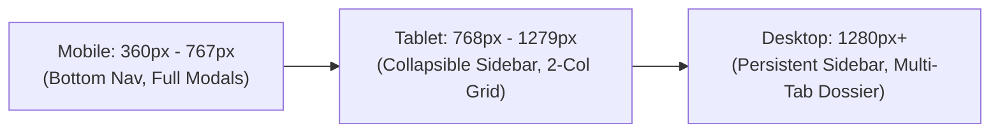

# DESIGN.md — Design System & UI/UX Specification

This document details the visual language, typography, layout rules, and component patterns for the BD Legal Practice Management system.

---

## 1. Visual Language & Principles

The interface is engineered specifically for legal professionals, advocates, and chamber clerks in Bangladesh. The design balances high data density with immediate legibility under intense courtroom and chamber working conditions.

### Core Tenets:
1. **Immediate Clarity**: Critical dates, court benches, and urgent matter statuses must be identifiable in under two seconds.
2. **Bilingual Elegance**: Seamless switching between English and Bangla without layout breakage, font mismatch, or clipping of Bangla matras/diacritics.
3. **Courtroom Reliability**: High-contrast typography and touch targets suitable for fast mobile entry on 3G/4G connections inside crowded courtrooms.
4. **Zero Accidental Loss**: Destructive actions (archiving, deleting, status changes) require explicit confirmation dialogs and provide undo or audit trails.

---

## 2. Color Palette & Semantic Tokens

The color system utilizes a refined Tailwind palette based on slate neutrals with purposeful semantic accents.

| Token | Tailwind Class | Hex Value | Primary Usage |
| :--- | :--- | :--- | :--- |
| **Neutral Base** | `slate-50` | `#F8FAFC` | Page backgrounds, subtle card fills |
| **Surface Card** | `white` | `#FFFFFF` | Card backgrounds, dialog bodies, table rows |
| **Borders** | `slate-200` / `slate-300` | `#E2E8F0` / `#CBD5E1` | Dividers, card borders, input strokes |
| **Body Text** | `slate-700` | `#334155` | Secondary text, descriptions, table cells |
| **Heading Text** | `slate-900` | `#0F172A` | Page titles, client names, case titles |
| **Primary Brand** | `indigo-600` / `indigo-700` | `#4F46E5` / `#4338CA` | Primary buttons, active tabs, links |
| **Success / Active**| `emerald-600` | `#059669` | Active licenses, held hearings, completed tasks |
| **Warning / Hearing**| `amber-500` / `amber-600`| `#F59E0B` / `#D97706` | Upcoming hearings, pending items, adjournment warnings |
| **Danger / Urgent** | `rose-600` / `rose-700` | `#E11D48` / `#BE123C` | Overdue tasks, expired licenses, destructive actions |

---

## 3. Typography & Bilingual Typography

### 3.1 Font Stack
```css
font-family: 'Plus Jakarta Sans', 'Noto Sans Bengali', system-ui, -apple-system, sans-serif;
```
- **Latin Characters**: 'Plus Jakarta Sans' provides high legibility for alphanumeric case numbers, file serials, and timestamps.
- **Bangla Characters**: 'Noto Sans Bengali' provides rendering for complex conjuncts (*juktakkhor*), vowel signs (*kar*), and diacritics.

### 3.2 Bangla Diacritic Protection
In standard web typography, complex Bangla vowel signs (such as *dirgho-i kar* or *rossho-u kar*) can get clipped vertically by tight CSS line heights.
- **Enforced Rule**:
  ```css
  [lang="bn"], .font-bengali, body {
    line-height: 1.5;
  }
  ```
- All input fields, table rows, and headers must preserve a minimum line height of `1.5` to prevent diacritic truncation.

---

## 4. Breakpoints & Responsive Behavior

The design is engineered to function across three canonical breakpoints:



### 4.1 Mobile Viewport (360px – 767px)
- **Navigation**: Fixed bottom navigation bar with 5 primary touch items:
  1. `Dashboard`
  2. `Cases`
  3. `Calendar`
  4. `Tasks`
  5. `More` (opens slide-over drawer for Clients, Files, Appointments, Settings).
- **Forms & Inputs**:
  - `input`, `select`, `textarea` font size enforced to `16px` minimum to eliminate iOS Safari auto-zooming.
  - Form modals expand to full screen (`w-full min-h-dvh`) with a fixed sticky footer for `Cancel` and `Save`.
  - Floating `+` action button in the bottom right corner with context-aware shortcuts (locked caseId/clientId).
- **Touch Target Rule**: All clickable elements (buttons, links, tab items, dropdown items) MUST have a minimum bounding box of **44×44px** (`.touch-target`).

### 4.2 Tablet Viewport (768px – 1279px)
- **Navigation**: Collapsible left sidebar.
- **Data Layout**: Split master-detail views or 2-column card grids.
- **Dossier Header**: Client photo and case summary display in a balanced two-column header with tap-to-call actions.

### 4.3 Desktop Viewport (1280px and above)
- **Navigation**: Permanent left navigation sidebar (240px width).
- **Workspace**: Full multi-tab working dossier (`Overview`, `Hearings`, `Tasks`, `Files`, `Activity`).
- **Data Tables**: High-density tables with sortable column headers, badge chips, and row action popovers.

---

## 5. Component Library & Interaction Patterns

### 5.1 Context-Aware Action Button (`ContextPlusButton`)
- Rendered consistently across the app.
- **Contextual Behaviors**:
  - Inside a Case Dossier: Offers `Add Hearing`, `Add Task`, or `Add File` with `caseId` and `clientId` prefilled and locked.
  - Inside a Client Profile: Offers `Add Case`, `Add Task`, or `Add File` with `clientId` prefilled and locked.
  - On the Calendar: Offers `Add Hearing` or `Add Task` with `scheduledAt` prefilled to the clicked date.
  - On List Screens: Launches that entity's primary creation modal.

### 5.2 Unified Entity Link (`EntityLink`)
- Standardized clickable chip used in tables, search results, and calendar events.
- Automatically handles permission checking (e.g. obscuring restricted cases for unauthorized staff).
- Navigates to dossier view or opens quick-edit modal via `openEntityModalById`.

### 5.3 Modals & Accessible Dialogs
- Backdrop click or `Escape` key closes dialogs.
- Form autofocuses on the first interactive element upon open.
- Focus trap prevents tabbing out of modal container while open.

---

## 6. Cause List Print Stylesheet

Lawyers and clerks require physical printed cause lists (*dockets*) to carry into courtrooms each morning.

### Print Specifications (`@media print`):
```css
@media print {
  @page {
    size: A4 portrait;
    margin: 12mm 15mm;
  }
  body {
    background: white !important;
    color: black !important;
  }
  .no-print {
    display: none !important;
  }
  .print-only {
    display: block !important;
  }
}
```
- **Hides**: Navigation headers, sidebar, search bars, action buttons, pagination, and status pills.
- **Renders**: Chamber name, court date, clean tabular docket with Case Number, Parties, Court / Bench, Purpose ("Date Fixed For"), and Notes.
- **Page Breaks**: Table rows utilize `page-break-inside: avoid` to prevent awkward splitting across sheets.
