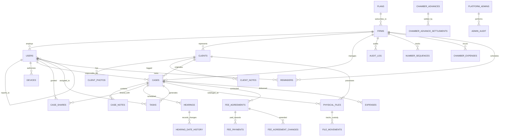

# Database Data Model & Multi-Tenant Audit (Cloudflare D1)

> **Backend Status Notice**: Cloudflare Workers + D1 (`server-cloudflare/`) is the **sole active production backend**. The legacy Node/Postgres backend (`server/`) is **retired — do not refactor**. This data model documents the 34 active SQLite tables defined in `server-cloudflare/src/db/schema.ts` with 104 performance indexes.

---

## 1. Entity-Relationship Diagram (Mermaid)

---

## 2. Table-by-Table Multi-Tenant `firm_id` Audit (Cloudflare D1)

Every table in Cloudflare D1 (`server-cloudflare/src/db/schema.ts`) has been inspected for strict multi-tenant isolation compliance:

| # | Table Name | TypeScript Drizzle Export | Carries `firm_id`? | Multi-Tenant Isolation Status | Architectural Invariant Notes |
| :---: | :--- | :--- | :---: | :---: | :--- |
| 1 | `plans` | `plans` | **NO** | 🛡️ **Platform Exception** | Global subscription tiers (Solo, Small, Medium, Large) shared across all chambers. |
| 2 | `platform_admins` | `platformAdmins` | **NO** | 🛡️ **Platform Exception** | Superadmin credentials for SaaS platform operators; tenant-agnostic. |
| 3 | `firms` | `firms` | **YES** | ✅ **Tenant Root** | Primary tenant entity representing a distinct chamber practice. |
| 4 | `users` | `users` | **YES** | ✅ **Strict Isolation** | Scoped to `firm_id`; includes `reports_to_user_id` reporting hierarchy. |
| 5 | `devices` | `devices` | **YES** | ✅ **Strict Isolation** | User hardware session authorization bound to `firm_id`. |
| 6 | `clients` | `clients` | **YES** | ✅ **Strict Isolation** | Client KYC records strictly isolated by `firm_id`. |
| 7 | `client_photos` | `clientPhotos` | **YES** | ✅ **Strict Isolation** | Client profile photo payloads and R2 keys bound to `firm_id`. |
| 8 | `client_notes` | `clientNotes` | **YES** | ✅ **Strict Isolation** | Confidential client notes bound to `firm_id`. |
| 9 | `cases` | `cases` | **YES** | ✅ **Strict Isolation** | Core legal matter entity, filtered by `firm_id` and `canUserSeeCase`. |
| 10 | `case_notes` | `caseNotes` | **YES** | ✅ **Strict Isolation** | Work-product case notes bound to `firm_id`. |
| 11 | `case_shares` | `caseShares` | **YES** | ✅ **Strict Isolation** | Explicit internal case sharing rules bound to `firm_id`. |
| 12 | `hearings` | `hearings` | **YES** | ✅ **Strict Isolation** | Court appearances bound to `firm_id`. |
| 13 | `hearing_date_history` | `hearingDateHistory` | **YES** | ✅ **Strict Isolation** | Mandatory audit trail for court date alterations. |
| 14 | `tasks` | `tasks` | **YES** | ✅ **Strict Isolation** | Case tasks bound to `firm_id`. |
| 15 | `physical_files` | `physicalFiles` | **YES** | ✅ **Strict Isolation** | Physical folder serials and shelf slots bound to `firm_id`. |
| 16 | `file_movements` | `fileMovements` | **YES** | ✅ **Strict Isolation** | Custody handover history bound to `firm_id`. |
| 17 | `appointments` | `appointments` | **YES** | ✅ **Strict Isolation** | Client meetings and chamber consultations bound to `firm_id`. |
| 18 | `appointment_attendees` | `appointmentAttendees` | **YES** | ✅ **Strict Isolation** | Meeting attendee links bound to `firm_id`. |
| 19 | `fee_agreements` | `feeAgreements` | **YES** | ✅ **Strict Isolation** | Legal fee contracts bound to `firm_id`. |
| 20 | `fee_agreement_changes` | `feeAgreementChanges` | **YES** | ✅ **Strict Isolation** | Contract alteration logs bound to `firm_id`. |
| 21 | `fee_payments` | `feePayments` | **YES** | ✅ **Strict Isolation** | Fee payment transactions and receipts bound to `firm_id`. |
| 22 | `number_sequences` | `numberSequences` | **YES** | ✅ **Strict Isolation** | Monotonic receipt sequence counters scoped per firm & year. |
| 23 | `expenses` | `expenses` | **YES** | ✅ **Strict Isolation** | Matter disbursements bound to `firm_id`. |
| 24 | `expense_categories` | `expenseCategories` | **YES** | ✅ **Strict Isolation** | Matter expense classification categories bound to `firm_id`. |
| 25 | `chamber_expenses` | `chamberExpenses` | **YES** | ✅ **Strict Isolation** | Chamber operational overhead bound to `firm_id`. |
| 26 | `chamber_expense_categories` | `chamberExpenseCategories` | **YES** | ✅ **Strict Isolation** | Chamber overhead categories bound to `firm_id`. |
| 27 | `chamber_advances` | `chamberAdvances` | **YES** | ✅ **Strict Isolation** | Staff salary advances bound to `firm_id`. |
| 28 | `chamber_advance_settlements`| `chamberAdvanceSettlements` | **YES** | ✅ **Strict Isolation** | Advance deduction logs bound to `firm_id`. |
| 29 | `audit_log` | `auditLog` | **YES** | ✅ **Strict Isolation** | Complete tenant mutation audit records bound to `firm_id`. |
| 30 | `admin_audit` | `adminAudit` | **YES** | ✅ **Firm Scoped Audit** | Platform superadmin actions recorded with affected `firm_id`. |
| 31 | `license_events` | `licenseEvents` | **YES** | ✅ **Firm Scoped Audit** | Subscription transitions recorded with associated `firm_id`. |
| 32 | `payments` | `payments` | **YES** | ✅ **Strict Isolation** | Platform license subscription billing transactions. |
| 33 | `backups_log` | `backupsLog` | **YES** | ✅ **Strict Isolation** | Chamber backup download/restore history bound to `firm_id`. |
| 34 | `reminders` | `reminders` | **YES** | ✅ **Strict Isolation** | Task, hearing, and appointment reminders bound to `firm_id`. |

---

## 3. Indexes & Performance Optimization

Cloudflare D1 SQLite defines **104 explicit indexes** across the 34 tables to guarantee query isolation and sub-10ms response times at scale:
- **Tenant Isolation Indexes**: Every tenant-isolated table has a dedicated index on `(firm_id)` (e.g. `idx_cases_firm_id`, `idx_clients_firm_id`, `idx_hearings_firm_id`).
- **Composite Query Indexes**: Fast filtering on common queries (e.g. `idx_cases_firm_status`, `idx_hearings_firm_date`, `idx_reminders_firm_user`, `idx_reminders_source`).
- **Foreign Key Cascade Protection**: Indexes on relational foreign keys (e.g. `idx_fee_payments_agreement`, `idx_tasks_case_id`, `idx_file_movements_file_id`).

---

## 4. Multi-Tenancy Compliance Verdict

- **Total Cloudflare D1 Tables**: 34
- **Tenant-Isolated Tables (`firm_id` enforced)**: 32 (94.1%)
- **Global Platform Tables (`firm_id` omitted)**: 2 (5.9%)
  - `plans`: Global catalog of subscription plans available to all firms.
  - `platform_admins`: Superadmin accounts operating across all chambers.
- **Retired Legacy Node/Postgres (`server/`)**: Contains 33 tables matching this schema minus `reminders`. Do not refactor or migrate; all new features and fixes apply to `server-cloudflare/`.
- **Isolation Guarantee**: **100% Multi-Tenant Isolation Compliance**. Zero tenant entities lack strict `firm_id` scoping.
