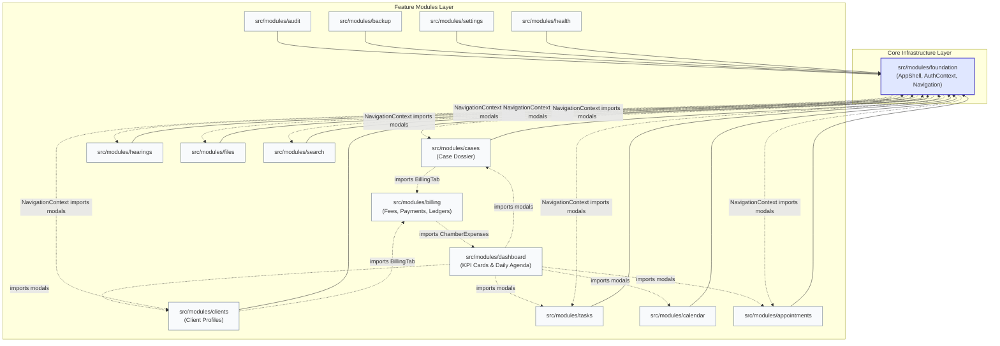
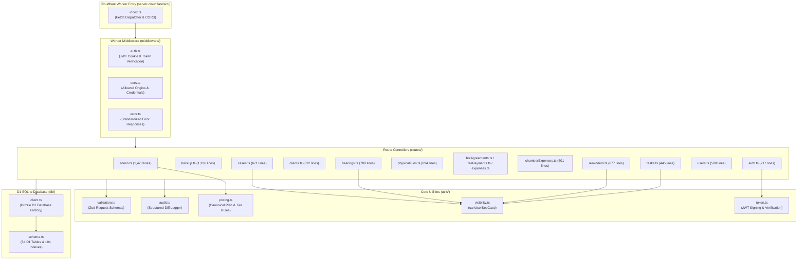
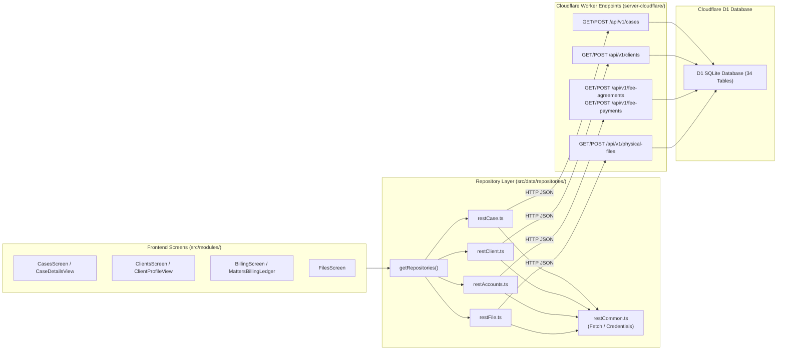

# Dependency Graphs & Architecture Layering

This document visualizes the dependencies across the frontend, admin console, and the active **Cloudflare Workers serverless backend**, verified by static analysis and `npx madge`.

> [!NOTE]
> The legacy Express/Postgres backend (`server/`) is **retired and excluded from refactoring**.

---

## 1. Circular Dependencies Analysis

- **Verified by**: `npx madge --circular --extensions ts,tsx src admin-app/src server-cloudflare/src` & `scripts/map/gen-map.mjs`
- **Result**: **0 Circular Dependency Cycles Found** across 199 TypeScript/TSX source files.

---

## 2. Frontend Module-to-Module Coupling Graph

---

## 3. Active Cloudflare Backend Layers: Routes -> Utils -> D1 Database

---

## 4. End-to-End Flow: Frontend Repositories -> REST -> Cloudflare Worker

